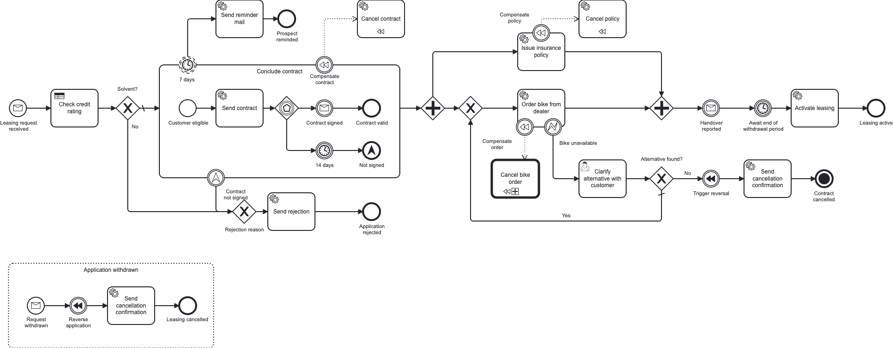

# CIB seven Bike-Leasing Blueprint

[](https://github.com/miragon-blueprints/cibseven-process-engine-api-example/actions/workflows/pre-merge-kotlin-gradle.yml) [](https://github.com/miragon-blueprints/cibseven-process-engine-api-example/actions/workflows/pre-merge-java-maven.yml) [](LICENSE)

A solution template to fork for automating a business process on [CIB seven](https://cibseven.org)
(the community fork of Camunda 7): one complete, production-shaped BPMN service on an **embedded
engine** with Spring Boot. It talks to the engine through the
[**process-engine-api**](https://github.com/bpm-crafters) (bpm-crafters) instead of the plain CIB seven
APIs, while Cockpit/Tasklist and `/engine-rest` remain available. It is still a work in progress.

<!-- variant:blueprint -->
## Pick your stack

| | [`kotlin-gradle/`](kotlin-gradle/README.md) | [`java-maven/`](java-maven/README.md) |
|---|---|---|
| **Stack** | Kotlin 2.4 · Gradle | Java 21 · Maven |
| **Choose it when** | you are free to choose — **our recommendation for a modern stack** | Java + Maven is your team's or company's standard, or you are in a training |

Both run the same process behind the same REST contract — [turn the repo into a single-stack starter](docs/starter.md) with one command.
<!-- /variant:blueprint -->

## The process



**MiraVelo** is a fictional bike brand that sells on a leasing model. The service takes a leasing
application from the first request to an active lease and deliberately covers the BPMN elements you
meet in real processes: a message start event, service tasks as process-engine-api workers and a DMN
business-rule task, an embedded sub-process with an event-based gateway and a non-interrupting
reminder timer, a parallel fork/join, a user task with a Camunda Form (completable in the Tasklist or
via REST), compensation / SAGA handlers guarded by error and escalation boundary events, a call
activity, a withdrawal message event sub-process and a terminate end event.

## Quick start

Requires JDK 21 and Docker (or Podman).

```bash
docker compose -f stack/docker-compose.yml up -d   # Postgres on :5432
# variant:kotlin-gradle
cd kotlin-gradle && ./gradlew :service:app:bootRun   # service + embedded engine on :8080
# /variant:kotlin-gradle
# variant:java-maven
cd java-maven && ./mvnw -pl service/app -am spring-boot:run   # service + embedded engine on :8080
# /variant:java-maven
```

| What | URL | Login |
|---|---|---|
| CIB seven webclient | <http://localhost:8080/webapp> | admin / admin |
| Classic Cockpit / Tasklist | <http://localhost:8080/camunda> | admin / admin |
| Swagger UI | <http://localhost:8080/swagger-ui.html> | |

Drive the whole process over REST: `cd bruno && npx --yes @usebruno/cli@4.0.0 run . --env local -r`.
Setup, ports, containers and tests are in [CONTRIBUTING.md](CONTRIBUTING.md).

## What's inside

| Path | Content |
|---|---|
| [`openapi/`](openapi/openapi.json) | the checked-in, drift-gated OpenAPI contract |
| [`bruno/`](bruno/README.md) | the REST scenarios, the two ways to complete a user task, the incident demo |
| [`stack/`](stack/docker-compose.yml) | the Postgres dev stack |
| [`docs/`](docs/README.md) | the Architecture Decision Records: why the repo is shaped this way |

## Contributing

Contributions are welcome — see [CONTRIBUTING.md](CONTRIBUTING.md).

## License

Licensed under the [MIT License](LICENSE).
